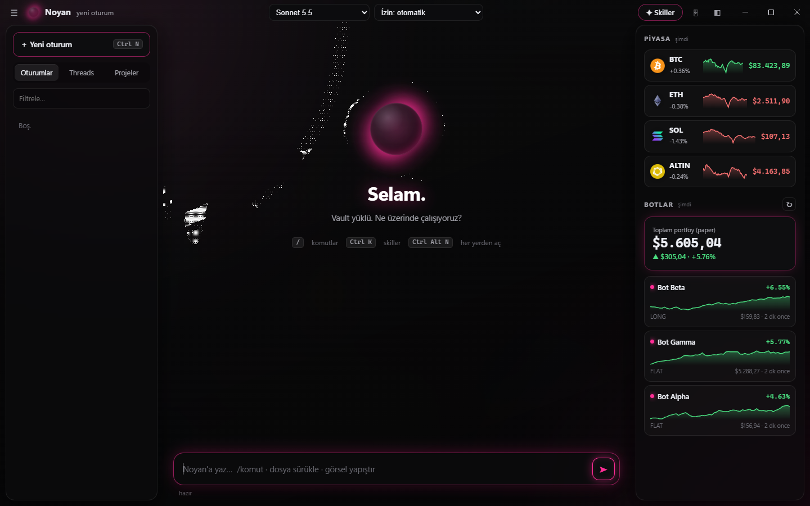

# Noyan Desktop


<sub>Screenshot uses a demo vault and fake bot data.</sub>

I use Claude Code inside an Obsidian vault that works as my notes and memory. I wanted it in its own window instead of a terminal, so I built this Electron app on top of the Claude Agent SDK.

It keeps one agent session open and streams messages into it, so follow-ups and interrupts don't restart anything. Every tool call shows up as a card where I can allow it once, allow it always, or deny it. Model and permission mode can be changed mid-session. Images can be pasted straight into the chat.

The sidebar reads the vault directly: past sessions (which can be resumed), open threads and project notes. The right panel shows crypto prices and, if you point it at one, a folder that exports bot balances.

It sits in the tray, opens with `Ctrl+Alt+N`, and if the window is in the background, it sends a notification when a reply is done or a tool call needs approval.

The UI and code comments are in Turkish.

## Running it

You need Claude Code installed and logged in.

```bash
npm install
set NOYAN_VAULT=C:\path\to\vault          # defaults to ~/Vault
set NOYAN_BOT_DIR=C:\path\to\bot_panel    # optional, folder with export_payload.py
npm start
```

## Files

```
main.mjs     agent session, permission handling, IPC, tray, hotkey
vault.mjs    reads sessions, threads, projects and bot data (read-only)
skills.mjs   lists available skills and slash commands
preload.cjs  bridge between the window and the main process
ui/          chat, side panels, skill browser
```

MIT license.
